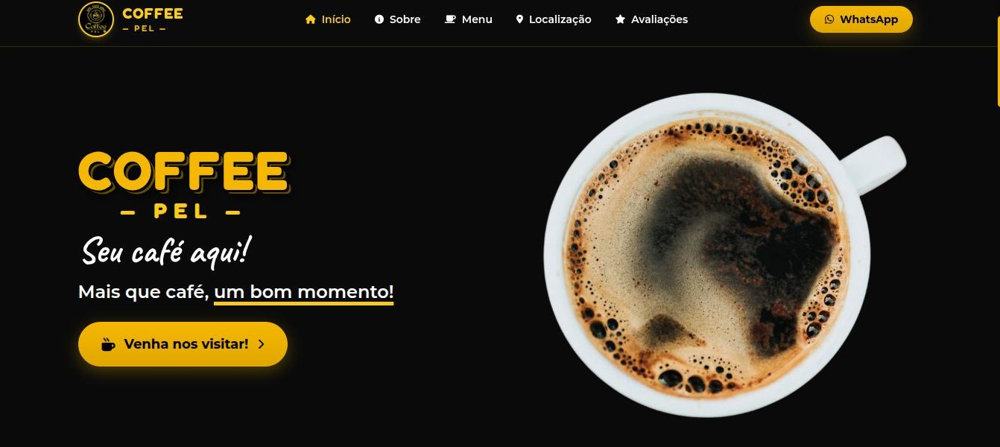
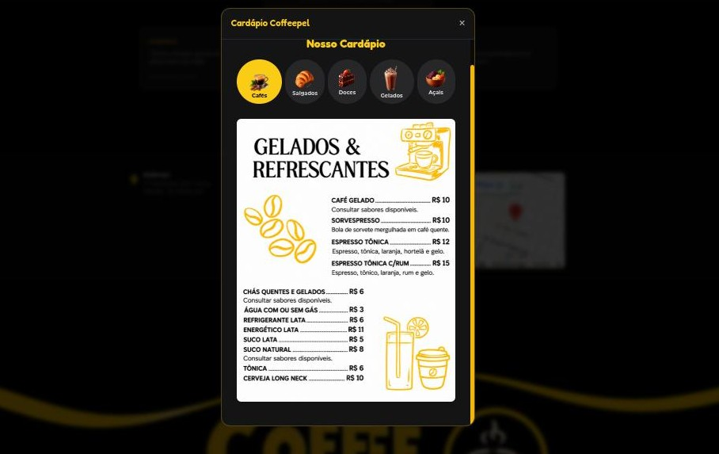
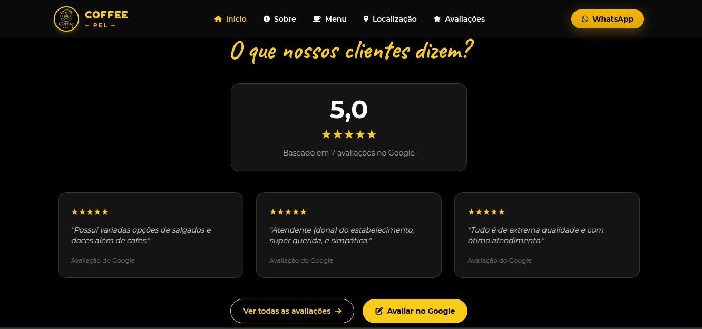
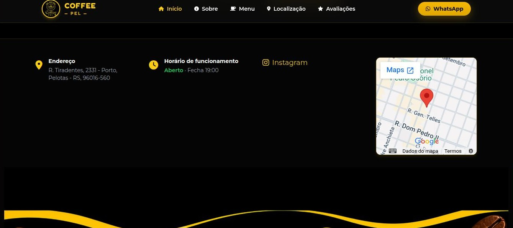

# ☕ Coffee Pel

Site institucional de cafeteria desenvolvido para fins acadêmicos e de aprendizado. Construído com HTML5, CSS3 e JavaScript puro (ES6+).

---

## Autores

- João Molina

---

## Visão Geral

O **Coffee Pel** é uma aplicação web desenvolvida para apresentar e divulgar a cafeteria, proporcionando aos visitantes uma experiência visual agradável e intuitiva. O site permite conhecer a cafeteria, explorar seus produtos, visualizar o cardápio e acessar informações importantes sobre localização e contato.

Este repositório serve como base acadêmica e demonstra conceitos como:

- Estruturação semântica com HTML5;
- Estilização responsiva e moderna com CSS3 puro;
- Manipulação dinâmica do DOM com JavaScript (ES6+);
- Criação de interfaces intuitivas e interativas;
- Organização modular de scripts e folhas de estilo;
- Adaptação de layouts para diferentes dispositivos.

---

## Tecnologias

- **HTML5** – Estruturação semântica das páginas web;
- **CSS3** – Estilização moderna, responsiva e com identidade visual personalizada;
- **JavaScript (ES6+)** – Adição de interatividade, manipulação do DOM e lógica da aplicação;
- **Font Awesome 6.4.0** – Biblioteca para inclusão de ícones e melhoria da experiência do usuário.

---

## Funcionalidades

- **☕ Apresentação da Cafeteria:** Exibição da identidade visual e apresentação da Coffee Pel;
- **📋 Cardápio:** Apresentação dos cafés, bebidas e acompanhamentos;
- **🍰 Divulgação de Produtos:** Exibição dos produtos oferecidos pela cafeteria;
- **📸 Galeria de Imagens:** Apresentação visual dos produtos e do ambiente;
- **📱 Redes Sociais:** Acesso rápido ao Instagram e outros canais de comunicação;
- **📍 Localização e Contato:** Informações para facilitar o acesso e a comunicação com a cafeteria;
- **📱 Menu Responsivo:** Navegação adaptada para dispositivos móveis;
- **🎨 Interface Responsiva:** Layout moderno e otimizado para celulares, tablets e computadores.

---

## 📸 Screenshots

Algumas capturas de tela para ilustrar as diferentes seções do site:

### ☕ Página Inicial

### 📋 Menu

### 🍰 Avaliações

### 📱 Localização

---

## 🚀 Melhorias e Próximos Passos

- Implementação de sistema de pedidos online;
- Integração com WhatsApp para facilitar pedidos e atendimento;
- Criação de um painel administrativo para gerenciamento de produtos;
- Integração com backend (Node.js/Express) e banco de dados;
- Implementação de filtros para categorias do cardápio;
- Melhorias de acessibilidade e otimização de desempenho;
- Integração com ferramentas de análise de acessos.
